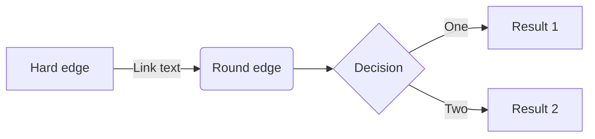
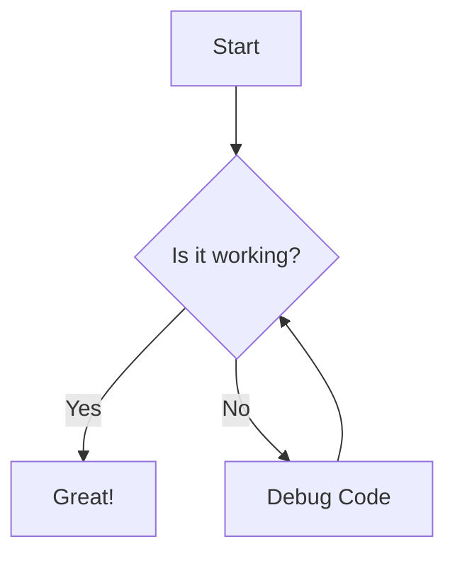

# local-dirt
Local Government Data Analysis Tool

LOCAL DIRT — LOCAL GOVERNMENT DATA COLLECTOR

## WHAT THIS DOES
This project collects publicly available local-government and community-news items from configured websites, filters them for relevance, and writes a compact JSON digest that can be reviewed by an AI assistant or a human editor.

The script is intentionally a collector, not an editor:

- Python gathers and normalizes items.
- The script tracks seen items to avoid re-emitting duplicates.
- A later step can pass the digest to an AI model for editorial sorting.

The collection loop is designed to be efficient. Each configured source has its own refresh interval, and the master run only checks sources whose interval has elapsed.

Example refresh defaults from the project configuration:

    Sports:                 120 minutes
    School/news:            360 minutes
    News:                   120 minutes
    Government/council:     360 minutes
    Planning/development:   360 minutes
    Transportation:         360 minutes
    Weather:                360 minutes

If the script runs at 8:00 and checks a council page, then runs again at 8:15, 8:30, 8:45, etc., it skips that source until its configured refresh period has elapsed.

## PROCESS FLOW

## CONFIGURATION
Normally you edit `config.json`, not the Python code.

The configuration includes:

- `sources`: the list of websites to crawl
- `scheduler.master_run_minutes`: how often the master loop runs
- `scheduler.default_refresh_minutes_by_category`: default refresh intervals by category
- `broad_source_keywords`: keywords used to keep only relevant local items from broader news sources
- `request`: HTTP and crawler settings
- `limits`: crawl and extraction caps

Each source can override the category default with its own `refresh_minutes` value.

Example source entry:

    {
      "name": "Forsyth County Sheriff's Office",
      "url": "https://www.forsythsheriff.org",
      "scope": "local",
      "category": "government",
      "refresh_minutes": 300,
      "crawl_depth": 3,
      "max_pages": 6,
      "max_item_age_days": 30,
      "is_feed": false
    }

Example broader-news entry:

    {
      "name": "Patch Cumming",
      "url": "https://patch.com/georgia/cumming",
      "scope": "local",
      "category": "news",
      "refresh_minutes": 120,
      "crawl_depth": 3,
      "max_pages": 6,
      "max_item_age_days": 30,
      "is_feed": false
    }

You can adjust the crawl intervals, categories, and keywords in `config.json` whenever needed.

## INSTALL
Open Command Prompt / PowerShell in this folder:

    py -m pip install -r requirements.txt

## MANUAL RUN
    py local_dirt.py

This writes the latest digest to:

    output\digest_latest.json

A timestamped copy is also written on each run.

## FORCE EVERYTHING TO RUN NOW
If you want to ignore the normal refresh timers:

    py local_dirt.py --force-refresh

If you also want previously seen items included:

    py local_dirt.py --force-refresh --all

## STATE FILES
`seen_items.json`
    Prevents old stories or items from being repeatedly emitted as new.

`last_checked.json`
    Remembers when each source was last checked, so a master run does not hammer every website on every cycle.

## IMPORTANT BEHAVIOR
A source that fails is not marked as successfully checked. That means it can retry on the next master run instead of waiting several hours or days.

## ADDING OR REMOVING SITES
Add a local site:

    {
      "name": "Example Town",
      "url": "https://example.gov/",
      "scope": "local",
      "category": "town",
      "refresh_minutes": 120
    }

Add a broad site where only local matches should survive:

    {
      "name": "Example News",
      "url": "https://example.com/",
      "scope": "local",
      "category": "news",
      "refresh_minutes": 30
    }

Add or remove local keywords under:

    "broad_source_keywords"

## OUTPUTS
The project currently writes two main artifacts to the `output` folder:

- `output/digest_latest.json` — the latest collected items in a JSON digest format
- `output/report_latest.md` — the AI-edited summary report generated from the digest

## AI REPORT WORKFLOW
The GitHub Actions workflow defined in `.github/workflows/run.yml` runs on a scheduled cron trigger and also supports manual runs from the Actions tab. It collects the latest items, then sends the digest to Groq for a concise editorial pass.

Required repository secret:

- `GROQ_API_KEY`

Optional environment setting:

- `GROQ_MODEL` (defaults to `openai/gpt-oss-120b`)

The workflow is configured in `.github/workflows/run.yml` and does the following:

1. Runs `python local_dirt.py`
2. Commits the digest to the repo output folder
3. Runs `python local_dirt_ai_report.py`
4. Commits the report to `output/report_latest.md`
5. Opens a GitHub issue containing the AI-generated report

## LIMITATIONS
No generic scraper can guarantee every website forever. Some sites change,
block automated requests, use JavaScript, or put documents inside special
systems.

Failures are recorded in the JSON `errors` section and do not stop the rest of the collection.

## SUGGESTED AI PROMPT
Upload `output/digest_latest.json` and say:

"Act as the editor of a concise Forsyth County local-news account.
Do not summarize everything. Review every item in this JSON, merge duplicate
stories, and choose only items that a meaningful number of Forsyth County
residents would care about. Prioritize major development, roads/closures,
restaurants and recognizable businesses, taxes, schools, school-board
decisions, public safety, major local government decisions, significant sports
results and unusual community news. When in doubt, skip it. For each selected
item, give me a short X/Facebook-ready post and preserve the original source
URL."

This matches the prompt used by `local_dirt_ai_report.py` and reflects the
current Forsyth County configuration rather than the earlier Southside Indianapolis
example.
